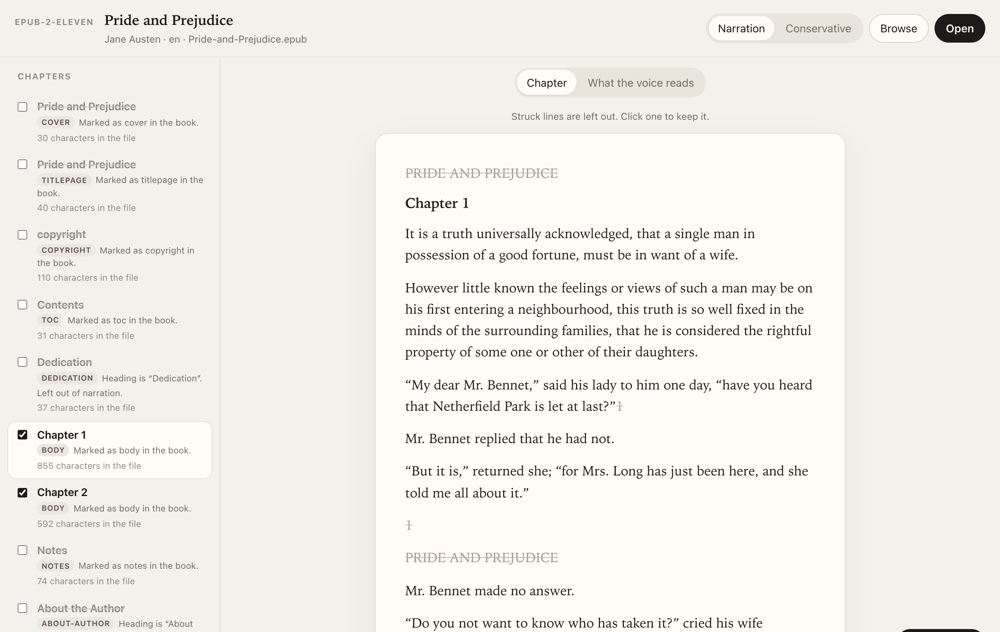
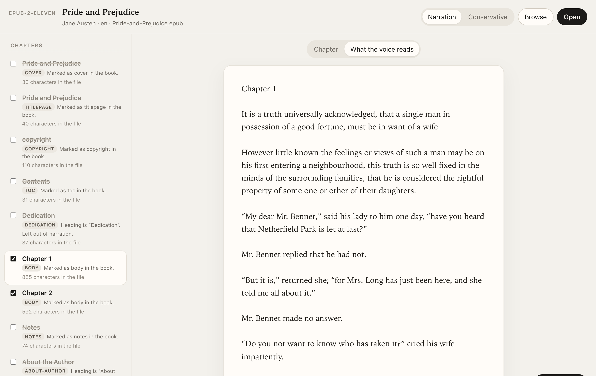

<div align="center">

# epub-2-eleven

**Strip the furniture from an EPUB so ElevenLabs reads the book, and nothing else.**

[](https://github.com/adamtty/epub-2-eleven/actions/workflows/ci.yml)
[](https://github.com/adamtty/epub-2-eleven/actions/workflows/codeql.yml)
[](https://scorecard.dev/viewer/?uri=github.com/adamtty/epub-2-eleven)
[](LICENSE)

</div>

ElevenLabs turns an EPUB into an audiobook by reading out every word in it. That includes the
copyright page, the table of contents, "47" at the bottom of every page, the running head at the top,
and the little "1" after a sentence that points at a footnote. You pay per character for all of it.

epub-2-eleven opens the book in a local page, works out which parts are the book and which are
furniture, and shows you the result before you commit: struck-out lines are cut, and one click puts
any of them back. Then it writes a clean EPUB 3 holding just the text the voice should read. The cover
image and the title metadata stay, so the book still looks right in ElevenLabs.



## What it cuts

There are two presets. You can override any chapter or line with a click.

| | **Narration** (default) | **Conservative** |
|---|---|---|
| Cover, title page, copyright, contents, colophon | cut | cut |
| Dedication, preface, foreword, introduction, acknowledgements, afterword | cut | kept |
| "Also by", about the author, index, glossary, bibliography, notes | cut | kept |
| Prologue and epilogue | kept | kept |
| Page numbers, running heads and footers, page breaks | cut | cut |
| Citation marks (`¹`, `[12]`, `”13`) | cut | cut |
| Footnotes, note references, captions, image descriptions | cut | kept |

It also tidies the text the voice reads:

- **Drop caps.** `<span class="dropcap">T</span>he night` is read as "The night", not "T he night".
- **Hyphens.** Soft hyphens are removed and words split across a line break are rejoined, while
  real hyphens like "Jean-Luc" stay.
- **Images.** A picture is replaced by its description, or left out entirely in Narration.

Chapters are recognised from the book's own markup where it has any (`epub:type`, landmarks, the
EPUB 2 guide), then from headings and filenames. Running heads and page numbers are found by what
repeats from chapter to chapter.

The **What the voice reads** tab shows the exact text that will be exported, with a live character
count, so you know what ElevenLabs will bill before you upload.



## Install

You need [uv](https://docs.astral.sh/uv/) (or pipx) and Python 3.12 or newer.

```bash
uv tool install git+https://github.com/adamtty/epub-2-eleven
epub-2-eleven
```

That starts the page on a random local port and opens it in your browser. Then either:

- click **Open** (macOS) to choose a file. The cleaned copy is written next to the original as
  `<name>-elevenlabs.epub`.
- drop an EPUB onto the page, or click **Browse**. The cleaned copy goes to `~/Downloads`.

Options: `--port 8765` picks a fixed port, and `--no-browser` stops it opening a tab. Press Ctrl-C to
stop it.

To try it without a book of your own, `scripts/demo_book.py` writes a small sample (the opening of
*Pride and Prejudice*, with made-up furniture):

```bash
git clone https://github.com/adamtty/epub-2-eleven && cd epub-2-eleven
uv run python scripts/demo_book.py demo.epub
uv run epub-2-eleven
```

### What it won't do

- **DRM.** A book with `META-INF/encryption.xml` is refused. epub-2-eleven only works on files you
  can already open, and it doesn't remove DRM.
- **Fixed-layout books** (comics, picture books, `rendition:layout` set to `pre-paginated`) are
  refused, because there the page furniture *is* the page.

## Security

epub-2-eleven runs entirely on your machine and makes no network requests. A book is untrusted
input, so it's handled like one:

- **Local only.** The server listens on `127.0.0.1` and answers only requests whose `Host` is its own
  loopback address and port, which blocks DNS-rebinding attacks.
- **Requests from other sites are refused.** Every request that does anything needs a random token
  issued when the server starts, plus a same-origin `Origin` and `Sec-Fetch-Site`. These are checked
  before the request body is read, and bodies are size-capped.
- **The preview can't run anything.** Chapter HTML is rebuilt from an allowlist of plain text tags
  and a few attributes. Links, images, scripts, styles, `<base>`, SVG, forms and event handlers never
  reach the page, and a strict Content-Security-Policy (`default-src 'none'; script-src 'self';
  base-uri 'none'; object-src 'none'; form-action 'none'`) backs that up.
- **Safe XML parsing.** XML is parsed with DTDs, entity expansion and network access turned off and
  libxml2's size limits on, so XXE and "billion laughs" files don't work.
- **No zip bombs.** Each file inside the EPUB is capped at 64 MB unpacked and the whole book at
  512 MB, whatever the zip headers claim.
- **Safe writes.** Uploads are written to a private temp folder (`0700`, `O_EXCL | O_NOFOLLOW`) and
  deleted once parsed. Exports are written to a temp file and renamed into place, so an existing
  symlink is replaced rather than written through.
- **Fuzzed.** The chapter and package parsers are fuzzed with
  [Atheris](https://github.com/google/atheris) in CI. That has already found and fixed three crashes,
  which are kept in `tests/fuzz-corpus/` as regression cases.

Found something? Please see [SECURITY.md](SECURITY.md) and report it privately.

## Development

```bash
uv sync
uv run pytest                     # unit, server and security tests
uv run ruff check src tests && uv run ruff format --check src tests
```

The fuzzers need Linux x86-64 (that's all Atheris publishes wheels for):

```bash
uv pip install --require-hashes --only-binary :all: -r tests/requirements-fuzz.txt
python tests/fuzz_chapter.py tests/fuzz-corpus/chapter -max_total_time=60
python tests/fuzz_package.py tests/fuzz-corpus/package -max_total_time=60
```

| Path | What's in it |
|---|---|
| `src/epubclean/parse.py` | reads the EPUB: container, package, spine, navigation, cover |
| `src/epubclean/classify.py` | decides each chapter's role and marks furniture inside chapters |
| `src/epubclean/render.py` | the spoken text and the sanitised preview, from the same cuts |
| `src/epubclean/export.py` | writes the clean EPUB 3 |
| `src/epubclean/server.py` | the local page and its API |
| `src/epubclean/web/` | the page itself (no build step, no dependencies) |

## Uninstall

```bash
uv tool uninstall epub-2-eleven
```

It keeps no settings or state. Uploads live in a temp folder that's removed when the server stops,
and the only files it ever writes are the `-elevenlabs.epub` copies you export.

## License

[MIT](LICENSE). Not affiliated with ElevenLabs.
